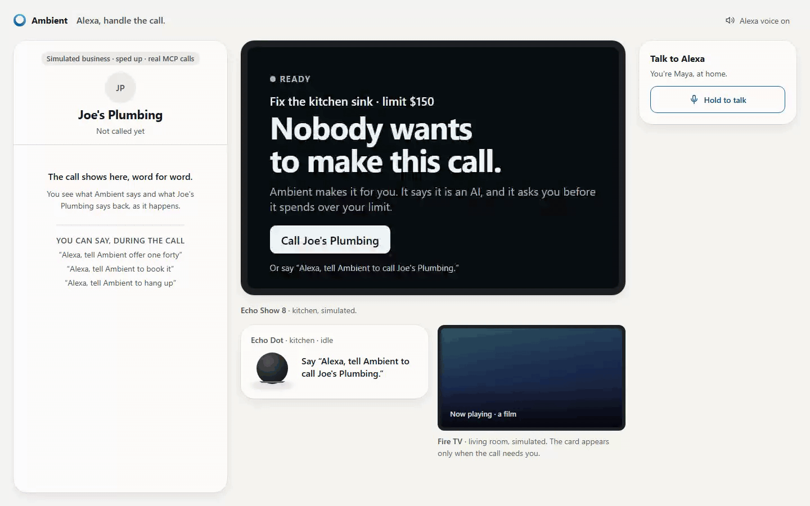
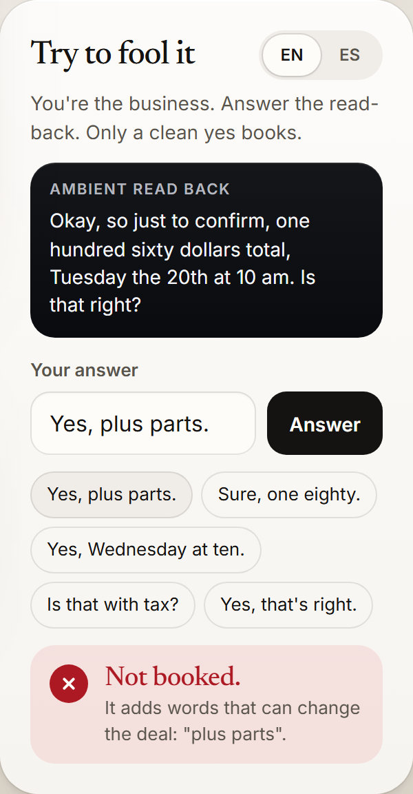
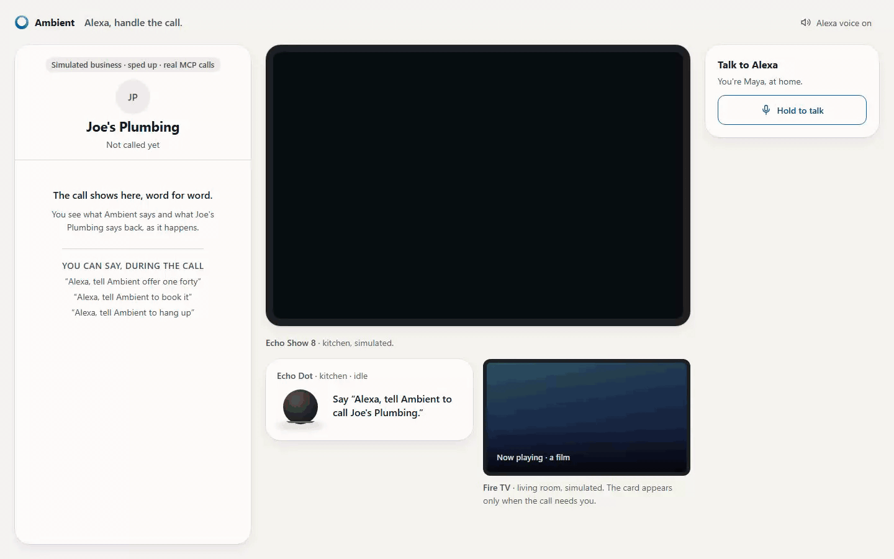
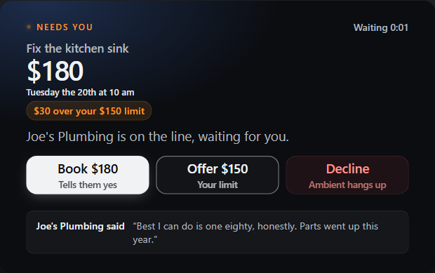
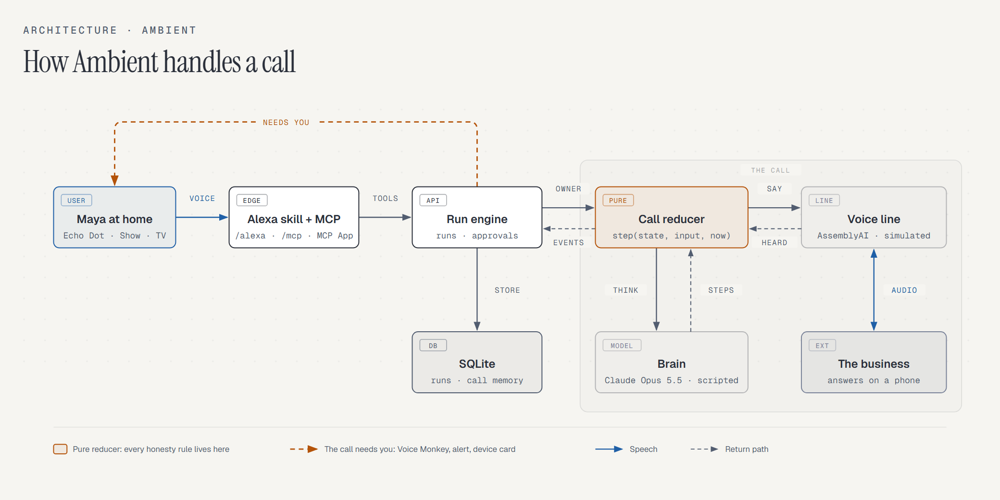
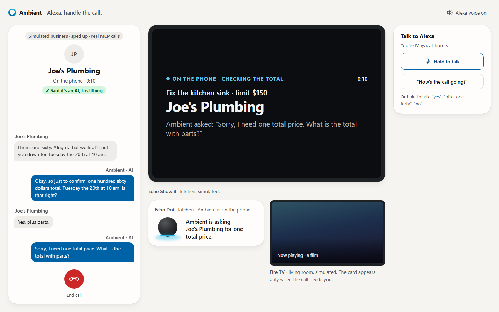
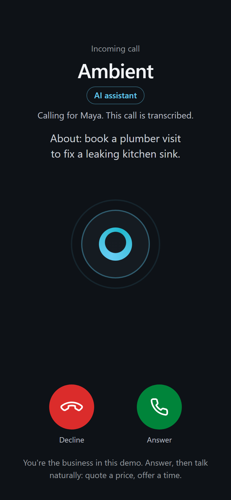

# Ambient

**An Alexa agent that phones a business for you.** It says first that it is an AI, never spends past your limit without asking, and books only on a clean yes.

[](docs/media/ambient-film.mp4)

**[Watch the 33-second film](docs/media/ambient-film.mp4)** · **[Try it in one minute, no keys](#try-it-one-minute-no-keys)** · **[Try to fool it](#honesty-rules)**

No live call has happened yet: the business and the Alexa+ host are simulated. The film re-enacts the demo call with text-to-speech voices, Pexels footage and the real simulator screens. Its source is in [`launch/film`](launch/film/SCRIPT.md).

## Try it: one minute, no keys

Needs Node 22.13 or later and pnpm (`corepack enable` installs it). From a clone of this repository:

```sh
pnpm install
pnpm demo   # then open http://127.0.0.1:3000/sim
```

No local setup? Open the repository in GitHub Codespaces. The container installs the project, starts the demo and opens `/sim`. Each Codespace has its own copy, so two judges never see each other's calls.

You say "Alexa, ask Ambient to call Joe's Plumbing, under 150." Ambient will not book on a price it did not read back, or on a yes with conditions attached. It keeps the yes that booked as proof.

Three moments from the demo:

1. **It refuses a false yes.** At the read-back, the plumber says "Yes, plus parts." Ambient does not book. It asks for one total price, reads the terms back again, and books on "Yes, that's right."
2. **It asks you before it spends more.** The plumber quotes $180 against your $150 limit. The call holds, and the Echo Show asks: "Book $180", "Offer $150" or "Decline". The plumber counters at $160, so the Show asks you again.
3. **It calls three plumbers at once, in two languages.** It books the cheapest quote under your limit and thanks the other two businesses. The cheapest plumber speaks Spanish, so Ambient books in Spanish while you read English on the Show.



**Try to fool it yourself.** In the simulator, you can play the business. Type any answer to the read-back, in English or Spanish. The same call reducer that runs every call decides, and the panel says whether Ambient would book and why.





The voice line, the Claude brain and the Alexa skill are built and tested against local fakes, but none has run live. See [What is real and what is simulated](#what-is-real-and-what-is-simulated).

## Who it is for

- **People who find a phone call hard.** For a deaf or hard-of-hearing owner, or an owner with a speech disability, the business is never on the owner's line. The owner reads each question on the Echo Show and answers with a tap. Ambient makes the call.
- **People who are busy when businesses are open.** The call holds only for the decisions that need the owner. One tap or one sentence answers it, and Ambient does the rest of the call.
- **Households and businesses that do not share a language.** The owner reads English on the Show while Ambient speaks Spanish to the business.
- **The business on the other end.** It hears that the caller is an AI before anything else. It gets a written receipt of what it agreed. "Take us off your list" stops every later call from Ambient.

## How it compares

"Not described" means that the pages we fetched on 2026-10-18 do not say. The [reference bar](docs/plans/2026-10-18-handle-the-call/reference-bar.md#5-full-comparison-table) holds the sources, and adds Pixel Call Screen and Apple's Call Screening and Hold Assist.

| | Google Duplex | Pixel Hold for Me | Ambient |
|---|---|---|---|
| Who places the call | The Assistant, for a client | The user | An AI agent, on the owner's request |
| Says it is an AI | No fetched source shows an "I am an AI" line | Not described | Yes, as the first words of the call |
| Asks the owner again when the business counters | Not described | Not described | Yes |
| Refuses an unclear yes such as "Yes, plus parts" | Not described | Not described | Yes |
| Keeps proof of the yes | Not described | Not described | Yes: the read-back, the reply and their times, and the recording on a live call |
| Works over a real phone network | Yes | Yes | No. The business answers on a web link |



| | |
|---|---|
| **Track** | Alexa+ |
| **Surfaces** | MCP server on `/mcp` (spec 2025-11-25, Streamable HTTP) · custom skill on `/alexa` · MCP App card `ui://ambient/task` · simulator on `/sim` |
| **Brain** | Claude Opus 5.5 (`claude-opus-5-5`) through the Anthropic API, or a scripted brain for the zero-key demo |
| **Voice line** | AssemblyAI Voice Agent API, with our own endpoint as its LLM |
| **Entry point** | `src/server.ts` |

## Run it

**Five-minute judge path:** run `pnpm demo`, open `/sim`, tap "Call Joe's Plumbing", and watch Ambient refuse "Yes, plus parts." Then type your own answers into "Try to fool it". Then tap "Start a new demo call" and "Get 3 quotes at once" to watch three calls run together. Then run `pnpm smoke:mcp`, `pnpm smoke:around`, `pnpm call:dry` and `pnpm scenarios`.

The demo needs no keys and no accounts. The business is simulated. Every action is a real MCP tool call. Measured on 2026-10-19 (Windows 11, warm pnpm store): `pnpm install` took 20 seconds from a fresh clone, and `pnpm demo` served `/sim` 2.5 seconds after it started. The first install on a cold store took 122 seconds.

```sh
corepack enable
pnpm install
pnpm demo
# open http://127.0.0.1:3000/sim and tap "Call Joe's Plumbing"
```

`pnpm smoke:mcp` drives the same call through `/mcp` from the command line. It fails unless the call ends confirmed at the counter the owner approved. Joe counters the owner's offer, so the owner is asked a second time. At the read-back, Joe answers "Yes, plus parts." Ambient does not book. It asks for the total and reads back again:

```text
> delegate {"task":"Call Joe's Plumbing and book a visit to fix the kitchen sink, keep it under 150","newConversation":true}
  Ambient reply: Joe's Plumbing wants one hundred eighty dollars for Tuesday the 20th at 10 am. Your limit is one hundred fifty dollars. Say yes to book it, offer a price like one fifty, or say no.
> status
  Ambient reply: Joe's Plumbing is holding at one hundred eighty dollars, over your limit of one hundred fifty dollars. Say yes to book it, offer a price like one fifty, or say no.
> delegate {"task":"offer 150"}
  Ambient reply: Okay, offering one hundred fifty dollars. To hear their answer, ask how it's going.
> status
  Ambient reply: Joe's Plumbing turned down your offer and is holding at one hundred sixty dollars, over your limit of one hundred fifty dollars. Say yes to book it, offer a price like one fifty, or say no.
> approve {"decision":"once"}
  Ambient reply: Joe's Plumbing confirmed Tuesday the 20th at 10 am for one hundred sixty dollars.
> status
  Ambient reply: Joe's Plumbing confirmed Tuesday the 20th at 10 am for one hundred sixty dollars.
```

The end of the same run, from the call transcript:

```text
  Maya: Approved: one hundred sixty dollars for Tuesday the 20th at 10 am
  Ambient: Okay, Maya says one sixty is fine. Please go ahead and book Tuesday at ten.
  Joe's Plumbing: Hmm, one sixty. Alright, that works. I'll put you down for Tuesday the 20th at 10 am.
  Ambient: Okay, so just to confirm, one hundred sixty dollars total, Tuesday the 20th at 10 am. Is that right?
  Joe's Plumbing: Yes, plus parts.
  Ambient: Sorry, I need one total price. What is the total with parts?
  Joe's Plumbing: Fair enough. A sink like that needs no parts, so that's all in.
  Ambient: Let me say it back, one hundred sixty dollars total, Tuesday the 20th at 10 am. Is that right?
  Joe's Plumbing: Yes, that's right. See you then.
  Ambient: Great, that's set for Tuesday the 20th at 10 am. Thanks so much, bye.
smoke: ok, the business countered, "yes, plus parts" did not book, and the call booked at the approved counter
```

The full run, with the call transcript, is in [`docs/demo/smoke-transcript.txt`](docs/demo/smoke-transcript.txt).

`pnpm scenarios` runs four more calls through the same reducer, with no server: a vet that gives no price (the owner is asked, and the read-back says "no price is set"), a business that never gives a clean yes (unconfirmed after three read-backs), no answer, and an owner who declines the price. Output: [`docs/demo/scenarios.txt`](docs/demo/scenarios.txt).

## How a call works



One pure function owns the call: `step(state, input, now)` in [`src/calls/session.ts`](src/calls/session.ts). It takes the current state and one input (the business spoke, the brain produced words, the owner decided, the line dropped) and returns the next state and a list of effects (say these words, think, hang up, tell the engine). It has no clock, no network, and no model inside it. Every honesty rule below is a table test against it.

A thin shell, [`src/calls/call.ts`](src/calls/call.ts), runs the effects. Two seams plug into it:

- **The line** carries speech as text. [`simulatedLine`](src/calls/line.ts) plays Joe's Plumbing for the demo. [`CallRoom`](src/calls/rooms.ts) is the real voice line.
- **The brain** decides what to say. [`claudeBrain`](src/calls/brain.ts) streams one turn from Claude with three strict tools: `ask_owner`, `end_call`, and `remember`. [`scriptedBrain`](src/calls/brain.ts) replays rules for the demo.

A call is a run in the existing engine ([`src/conversations.ts`](src/conversations.ts)), so the MCP tools, the Alexa skill, and the simulator all see the same state.

## Honesty rules

Rules 1 to 4 and 8 are enforced in the call reducer and tested in [`test/call-session.test.ts`](test/call-session.test.ts). Rules 5 and 6 are enforced in the caller runtime and tested in [`test/caller.test.ts`](test/caller.test.ts). Rule 7 is enforced in the errand reducer and tested in [`test/errand.test.ts`](test/errand.test.ts).

| Rule | What the code does |
|---|---|
| 1. The first words are an AI disclosure | The line speaks "Hi, this is an AI assistant calling for Maya. This call is transcribed." If the business cuts it off, the agent says it again before anything else. A business that speaks Spanish hears the disclosure, the read-back and every fixed line in Spanish, from one table in `src/calls/language.ts`. |
| 2. "Confirmed" means the business confirmed | The call books only on a short, clean yes to a fully played read-back of the exact total and time ("Okay, so just to confirm, one hundred sixty dollars total, Tuesday the 20th at 10 am. Is that right?"). The details are under this table. |
| 3. A price above the limit needs the owner | The reducer turns an over-limit confirmation into a question for the owner. Only a clear offer ("offer 160", "one sixty") counts as approval. "Don't pay 180" does not. A declined price ends the call with no deal. A deal with no price also needs the owner. |
| 4. No card numbers | Runs of 12 or more digits, spoken or written, become "that number". The check holds digits back across stream chunks, so a number split over several chunks is still caught. |
| 5. Dialing an unknown business needs approval | A business found by web search gets a "Call them?" approval. A number the user gives is dialed directly. |
| 6. Call limits | At most 3 calls to one number and 20 calls in total per 24 hours, on real lines, counting calls still in progress. |
| 7. One booking when calling around | The errand books at most one quote: the cheapest under the limit, or the cheapest after the owner says yes. Every other quote is released, and the business hears "Thanks so much for the quote. Maya is going with another option this time." A pick within the limit never writes an owner note, so the transcript never claims the owner approved it. |
| 8. "Don't call us" is final | A business line such as "take us off your list" or "don't call us with an AI" ends the call with no booking. Ambient remembers it in its call memory, which is on by default, and never dials that number again. A line such as "take me off speaker" or "never call before nine" is not an opt-out. |

Rule 2 in detail:

- Only the brain's `end_call` can start a booking. The reducer then reads the terms back word for word.
- The read-back counts only after it has fully played. The voice page reports playback, and speech during playback that is not agreement cancels it.
- The reply books only if it is short, contains a confirmation word ("yes", "that's right", "sounds good"), and otherwise holds only courtesy words and the exact amount and time from the read-back. Any other word or number, a negation, or a question returns to the conversation.
- Each retry is worded differently, so a late playback report cannot arm the wrong one.
- After three unanswered read-backs, or five in all, the call ends unconfirmed. A dropped line is always unconfirmed.
- A labelled corpus of 192 replies pins the reply check. A seeded test plays 4,000 generated calls and checks that every booking followed a clean yes to a read-back of that exact amount.
- In Spanish, the reply books only if it is a clean yes ("sí", "correcto", "así es", "de acuerdo") with courtesy words and nothing else. Any number, qualifier or question returns to the conversation. The read-back needs a plain Spanish day and time that names the same day, date and hour as the English booking it records. Its price is spoken in Spanish words.
- Each booking keeps its proof: the full read-back the business heard and the reply that booked it, each with its time. The 4,000-call test checks that the proof is exactly that pair. The card quotes both lines. On a live call, "Hear them say yes" plays that moment from the call recording. AssemblyAI records each voice session, and Ambient finds the read-back in the session timeline. It plays a recording only from the agent that made this call. The simulator has no recording, so there the card speaks both lines. `pnpm call:dry` checks the recording path against a local fake. No real recording has played yet.



Joe says "Yes, plus parts." and Ambient does not book.

Each rule maps to tests. The names below are the exact `it(...)` names.

| Rule | Test file | Tests |
|---|---|---|
| 1. AI disclosure first | [`test/call-session.test.ts`](test/call-session.test.ts) | "records the disclosure as the first turn when the business answers"<br>"repeats the disclosure before anything else when the business cut it off" |
| 2. "Confirmed" means the business confirmed | [`test/call-honesty.test.ts`](test/call-honesty.test.ts)<br>[`test/call.test.ts`](test/call.test.ts) | "books only on a clean yes to a read-back of that exact amount, within the limit or with the owner's approval"<br>"does not book on \"yes, plus parts\" and reads the total back again" |
| 3. A price above the limit needs the owner | [`test/call-session.test.ts`](test/call-session.test.ts) | "turns an over-limit confirmation into a question for the owner"<br>"ends without a deal instead of asking again after the owner declines that price" |
| 4. No card numbers | [`test/call-session.test.ts`](test/call-session.test.ts) | "never speaks a card number, even split across stream deltas"<br>"keeps redacting digits that keep streaming after a card number" |
| 5. Dialing an unknown business needs approval | [`test/caller.test.ts`](test/caller.test.ts) | "asks to dial the first candidate and moves to the next on deny"<br>"dials a number given in the instruction with no dial approval" |
| 6. Call limits | [`test/caller.test.ts`](test/caller.test.ts) | "ends no_deal at the per-number daily limit without dialing"<br>"counts calls still in progress against the daily limit" |
| 7. One booking when calling around | [`test/errand.test.ts`](test/errand.test.ts) | "holds every rule across 4,000 random orderings of three businesses"<br>"books the cheapest quote within the limit and releases the others" |
| 8. "Don't call us" is final | [`test/call-session.test.ts`](test/call-session.test.ts)<br>[`test/caller.test.ts`](test/caller.test.ts) | "ends politely, books nothing, and remembers it"<br>"never calls a business again after it asked not to be called by an AI" |

[`test/read-back-replies.test.ts`](test/read-back-replies.test.ts) adds the 192-reply corpus for rule 2.

Three adversarial reviews of the reducer and repeated structural review rounds, all by AI reviewers, tried to break these rules and the voice line. Each round is logged in [progress.md](progress.md). Each defect they reproduced is now a regression test.

## The house

- **Echo Dot.** The custom skill ([`src/alexa.ts`](src/alexa.ts), [`alexa/interaction-model.en-US.json`](alexa/interaction-model.en-US.json)) starts, steers, approves, and ends calls in one sentence each. When a call needs the owner, a Voice Monkey announcement speaks the question and Proactive Events adds a notification ([`src/cue.ts`](src/cue.ts)).
- **Echo Show and Fire TV.** The MCP App card leads with the stake ("$180 · Tuesday the 20th at 10 am"). On a screen it carries "Book $180", "Offer $150", and "Decline", which call the `approve` and `delegate` tools through the host. If the business agrees a day but gives no calendar date, the card says "Booked · date still open" with "Only the weekday was given · ask <business> for the date", and Alexa adds "They gave a day but no date, so check which one."
- **Calling around.** One instruction calls up to three businesses at the same time. The Echo Show shows a tile per business: ringing, on the phone, its quote, then booked or passed. The booked card names the cheapest quote and lists the passed ones.
- **Fire TV.** When the call needs the owner, the film pauses, the picture dims, and a corner card shows the stake. It plays on once the owner answers from any device.
- **Moving a booking.** Say "Alexa, move the plumber to Thursday." Ambient calls the business it last booked and asks to move the visit. The price you approved carries over, and the new time still books only through a read-back and a clean yes. A request about another trade, such as "move my dentist appointment", does not move the plumber ([`test/caller.test.ts`](test/caller.test.ts)).
- **Calling again.** If a call ends without a booking, say "call them again". Ambient redials the same business with the original job. It does not redial a call that booked or one that is still going ([`test/alexa.test.ts`](test/alexa.test.ts)).
- **Memory.** Each call is stored in SQLite. The next call to the same business starts with what the last one learned ("Remembered from Oct 18 — confirmed, quoted one hundred sixty dollars, Tuesday the 20th at 10 am").

## Real calls

There is no phone network in this version. AssemblyAI cannot dial out, and a paid Twilio account was out of budget. Instead, the business answers on a web link, which a phone browser opens like an incoming call:



For each call, [`src/calls/rooms.ts`](src/calls/rooms.ts) creates an AssemblyAI agent. The agent's greeting is the disclosure, spoken word for word. Its LLM is our own endpoint, `/call/<id>/v1/chat/completions`. That endpoint passes each business turn into the reducer and streams back exactly what the reducer says. The honesty rules therefore hold on the real voice line too. The page streams audio straight to AssemblyAI with a single-use token, so the API key stays on the server.

```sh
cp .env.example .env
# in .env: ANTHROPIC_API_KEY, ASSEMBLYAI_API_KEY and an https PUBLIC_BASE_URL
pnpm call
```

## Verification

```sh
pnpm scan    # typecheck, eslint, knip, and the full test suite
pnpm build
pnpm smoke:mcp            # a full simulated call through /mcp
pnpm smoke:around         # three simulated businesses at once through /mcp; the cheapest under the limit books
pnpm call:dry             # the same call over the AssemblyAI voice-line code, against a local fake of AssemblyAI (no keys); the first line it prints is "brain: scripted … AssemblyAI: a local fake"
python scripts/shots-sim.py   # every call state, light and dark, into docs/media/ (start pnpm demo with AMBIENT_DATA_DIR set to an empty directory first)
pnpm brain:latency        # time to first word on Claude (needs ANTHROPIC_API_KEY)
```

## Limits, stated plainly

- The real voice line has not yet run against the live AssemblyAI API. The request AssemblyAI sends to our endpoint is undocumented, so the endpoint reads it defensively ([friction log](docs/friction-log.md)).
- `pnpm brain:latency` has not run yet, so the time to the first word on a live call is not measured. Our own part is measured: in three `pnpm call:dry` runs on 2026-10-19, with the scripted brain over loopback, our endpoint sent its first word 3 to 6 ms (p50) and at most 12 ms after AssemblyAI's request. The honesty checks therefore add almost nothing to a turn. Claude's time to the first token and AssemblyAI's speech time come on top.
- The cost of a call is estimated, not measured: about 26 to 31 cents for the demo call, of which AssemblyAI is about 23 cents and Claude about 3 to 8 cents. The [submission](docs/DEVPOST.md#what-it-does-not-do) shows the arithmetic.
- The Echo Dot flow needs the custom skill deployed to a public HTTPS host. The AWS stack is prepared (`pnpm infra:synth`) but not deployed.
- The simulator stands in for the Alexa+ host. It is a real MCP client over loopback.

## What is real and what is simulated

| Piece | Status | Evidence |
|---|---|---|
| MCP server on `/mcp` (spec 2025-11-25, Streamable HTTP) | Real | `pnpm smoke:mcp` runs a full call through it; `test/mcp.test.ts` |
| Simulator on `/sim` | Real | A real MCP client over loopback, standing in for the Alexa+ host, which was gated as of 2026-10-18 |
| MCP App card `ui://ambient/task` | Real | Rendered by the `/sim` host; not yet rendered by an Alexa+ host |
| Call reducer honesty rules (`src/calls/session.ts`) | Real | Table tests (`test/call-session.test.ts`), a 192-reply corpus (`test/read-back-replies.test.ts`), and a seeded property test over 4,000 generated calls (`test/call-honesty.test.ts`) |
| Scripted brain and the demo business | Simulated | `simulatedLine` plays Joe's Plumbing in `pnpm demo`; every action is a real MCP tool call |
| Claude brain (`claudeBrain` in `src/calls/brain.ts`) | Built but not yet run live | Tests against a stubbed stream (`test/brain.test.ts`); `pnpm brain:latency` has not run |
| AssemblyAI voice line and chat-completions shim (`src/calls/rooms.ts`) | Built but not yet run live | `pnpm call:dry` runs a full call over real sockets against a local fake of AssemblyAI (`scripts/fake-assemblyai.ts`), using the request shape we assume from the docs; `test/assemblyai-line.test.ts` and `test/call-routes.test.ts`; no live API call yet ([friction log](docs/friction-log.md)) |
| Business answer page (`web/call`) | Built but not yet run live | Rendered screenshot `docs/media/call-business-ringing.png` |
| "Try to fool it" panel on `/sim` | Real | Each answer runs through the call reducer (`src/calls/fool.ts`, `test/fool.test.ts`) |
| Spanish voice line (voice `lola`, Spanish speech recognition, Spanish call page) | Built but not yet run live | `test/recording.test.ts`; screenshot `docs/media/call-business-ringing-es.png` |
| Recorded proof of yes (`hear_proof`) | Built but not yet run live | `pnpm call:dry` checks the path against the local fake; `test/recording.test.ts` |
| Live-call preflight (`pnpm call:preflight`) | Built but not yet run with real keys | `test/preflight.test.ts` |
| Alexa custom skill on `/alexa` | Built but not yet run live | `test/alexa.test.ts`; needs a public HTTPS deploy and an Echo Dot |
| Spoken cue and notification (`src/cue.ts`) | Built but not yet run live | `test/cue.test.ts`; needs a Voice Monkey token and Echo hardware |
| Business discovery by web search (`src/calls/discover.ts`) | Built but not yet run live | `test/discover.test.ts`; a real search needs `ANTHROPIC_API_KEY` |
| Call memory in SQLite (`src/store.ts`) | Real | The next call brief carries a "Remembered from" line (`test/caller.test.ts`) |
| AWS deployment (`infra/`) | Built but not yet run live | `pnpm infra:synth` synthesizes the CDK stack; nothing is deployed |
| An outbound phone call, a real phone ringing | Not built | No dial-out exists without paid Twilio; the business answers on a web link instead |

## Docs

[Plan](docs/plans/2026-10-18-handle-the-call/overview.md) · [AssemblyAI reference](docs/plans/2026-10-18-handle-the-call/reference-assemblyai.md) · [Alexa reference](docs/plans/2026-10-18-handle-the-call/reference-alexa.md) · [friction log](docs/friction-log.md) · [product feedback](docs/product-feedback.md) · [CONTRIBUTING](CONTRIBUTING.md)
